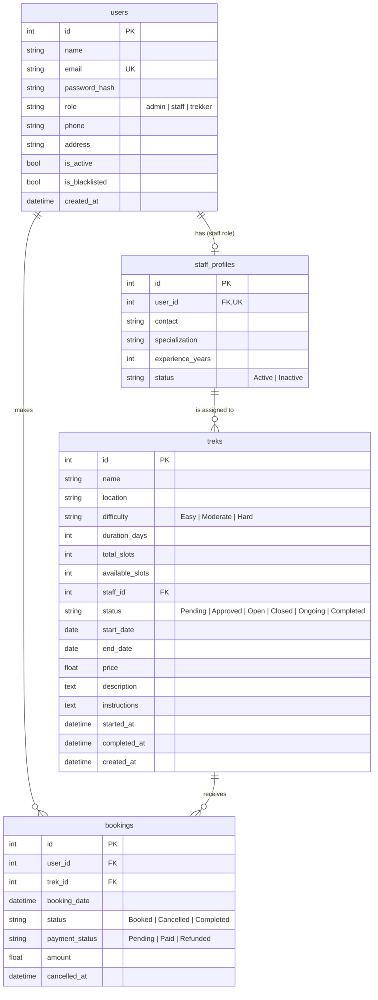

# ER Diagram - Trekking Management Application V2

Image version for the report: `docs/er_diagram.png` (also `docs/er_diagram.svg`).

## Relationships
- **users - staff_profiles (1 : 0..1):** every user with the `staff` role has exactly one staff profile; `user_id` is unique.
- **staff_profiles - treks (1 : N):** a staff member can be assigned many treks; a trek has at most one assigned staff member (`treks.staff_id`, nullable until assigned).
- **users - bookings (1 : N):** a trekker makes many bookings.
- **treks - bookings (1 : N):** a trek receives many bookings.

## Constraints
- `users.email` is unique.
- `bookings (user_id, trek_id)` is unique, which prevents duplicate bookings. A cancelled booking is reactivated if the user books again.
- Overbooking is prevented by an atomic `UPDATE treks SET available_slots = available_slots - 1 WHERE id = ? AND status = 'Open' AND available_slots > 0`.
- Exactly one admin user exists, created programmatically on first start (`backend/seed.py`).
